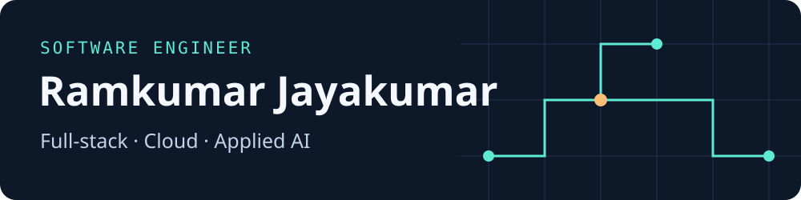

I’m a senior software engineer at Presidio. My work spans full-stack development, cloud architecture, and applied AI. I share what I learn through demos, technical writing, and talks.

[DEV Community](https://dev.to/rkj180220) · [LinkedIn](https://www.linkedin.com/in/ramkumarjayakumar/)

## 01 / Featured repositories

| Project | What it does |
| --- | --- |
| **[Cloud Orchestrator](https://github.com/rkj180220/Dissertation)** · Agentic AI | My BITS Pilani M.Tech dissertation. A decision support system that compares cloud resources and automates parts of the procurement workflow. |
| **[Predictive Maintenance Pipeline](https://github.com/rkj180220/predictive-maintenance-ml-pipeline)** · ML engineering | Turns NASA turbofan telemetry into features for model training and evaluation, with data checks and monitoring built into the pipeline. |
| **[ChordBook](https://github.com/rkj180220/rk-music-notes)** · Product engineering | An offline app I built for rehearsals and gigs. Organise chord sheets by band, transpose songs on the fly, and export them as portable HTML. |
| **[Secure Document Sharing](https://github.com/rkj180220/secure-doc-sharing)** · Full-stack and infrastructure | A document sharing app built with React and TypeScript, backed by AWS Amplify and provisioned with Terraform. |
| **[Bedrock Web Crawler](https://github.com/rkj180220/bedrock-web-crawler)** · Cloud and AI | A React app where you can ask questions about a website. A Bedrock agent calls a Lambda scraper, with AWS CDK defining the infrastructure. |
| **[GraphQL Real-Time Updates](https://github.com/rkj180220/graphql-real-time-updates-demo)** · APIs | An Angular and Amplify demo for exploring real-time GraphQL updates with AppSync and DynamoDB. |

## 02 / Writing and talks

- [The Answer Looked Fine. The AI Bill Didn’t.](https://dev.to/rkj180220/the-answer-looked-fine-the-ai-bill-didnt-1d47) — How Balaji Saravanan and I turned a chatbot cost regression into a detective game for Presidio India Exchange 2026, plus how to build a release gate for cost and quality.
- [Getting the actual client IP behind an AWS load balancer](https://dev.to/rkj180220/getting-the-actual-client-ip-when-using-application-load-balancer-alb-in-aws-lambda-4fcn)
- [Persistent data grids in Angular](https://dev.to/rkj180220/persistent-data-grids-in-angular-a-comprehensive-guide-4jbf)

Tools, education, and collaboration

**Tools:** TypeScript, Angular, React, Python, GraphQL, and AWS.

**Education:** M.Tech in Cloud Computing, BITS Pilani (WILP) · B.Tech in Information and Communication Technology, SASTRA University.

I’m open to collaborations and new projects across software engineering, cloud, and AI. [Say hello on LinkedIn](https://www.linkedin.com/in/ramkumarjayakumar/).

