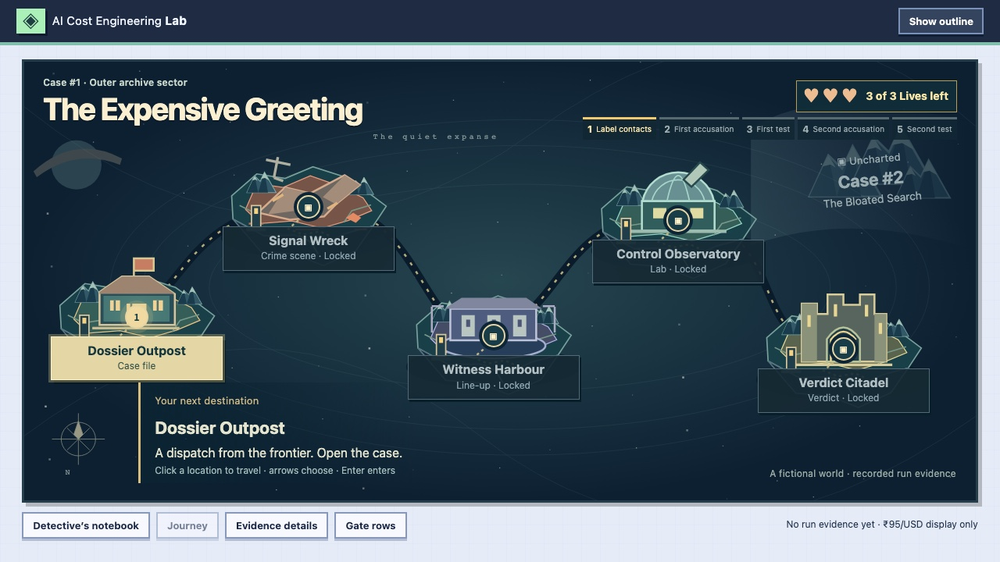

I’m a senior software engineer at Presidio. My work spans full-stack development, cloud architecture, and applied AI. I share what I learn through demos, technical writing, and talks.

[DEV Community](https://dev.to/rkj180220) · [LinkedIn](https://www.linkedin.com/in/ramkumarjayakumar/)

## 01 / Featured build

### The Expensive Greeting

A chatbot gives the same answer after a release. Why does it cost more? For Presidio India Exchange 2026, Balaji Saravanan and I turned that question into a detective game. Follow the request trace, test a fix, and see whether it passes a release gate for cost and answer quality.

[Read the case and see how the gate works →](https://dev.to/rkj180220/the-answer-looked-fine-the-ai-bill-didnt-1d47)

## 02 / Project index

- **[Cloud Orchestrator](https://github.com/rkj180220/Dissertation)** · My M.Tech dissertation. An agentic decision support system for comparing cloud resources and automating procurement workflows.
- **[GraphQL real-time updates](https://github.com/rkj180220/graphql-real-time-updates-demo)** · A demo for exploring how GraphQL apps receive live updates.
- **[Bedrock web crawler](https://github.com/rkj180220/bedrock-web-crawler)** · A React app with Bedrock and Lambda that answers questions about the pages it crawls.
- **[RK Music Notes](https://github.com/rkj180220/rk-music-notes)** · I play piano and guitar, so I built a way to organise chord sheets and band arrangements and export them as portable HTML.

## 03 / From my notebook

- [Getting the actual client IP behind an AWS load balancer](https://dev.to/rkj180220/getting-the-actual-client-ip-when-using-application-load-balancer-alb-in-aws-lambda-4fcn)
- [Persistent data grids in Angular](https://dev.to/rkj180220/persistent-data-grids-in-angular-a-comprehensive-guide-4jbf)

Tools, education, and collaboration

**Tools:** TypeScript, Angular, React, Python, GraphQL, and AWS.

**Education:** M.Tech in Cloud Computing, BITS Pilani (WILP) · B.Tech in Information and Communication Technology, SASTRA University.

I’m open to collaborations and new projects across software engineering, cloud, and AI. [Say hello on LinkedIn](https://www.linkedin.com/in/ramkumarjayakumar/).

